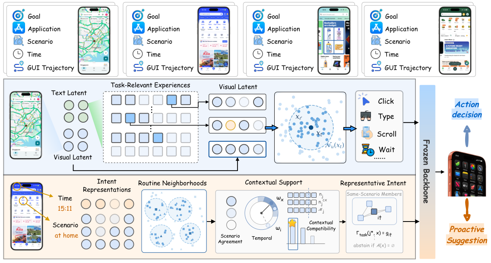

# ExpActivator
**Relevance Does Not Imply Applicability: Experience Activation for Personal GUI Agents**

Fuyao Zhang, Xuan Wang, Zherui Li, Jiaming Zhang, Longtao Huang, Wei Yang Bryan Lim

[Paper](https://arxiv.org/abs/2609.33304) · [PDF](https://arxiv.org/pdf/2609.33304)

<p align="center">
  
</p>

## Overview

Personal GUI agents usually append retrieved user history to the policy context and assume it stays useful at every step of a task. ExpActivator treats history as something to **activate**, not just retrieve:

- **Step-level activation.** Each new screen is matched to historical states in the latent space of the frozen GUI backbone, and the matching historical action is given to the policy as a reference it may adopt, adapt, or reject.
- **Task-level activation.** A recurring intent is proposed proactively only when time and scenario support it, and the method abstains otherwise.

It is training-free: no model or prediction parameter is fitted, and the backbone stays frozen. It is evaluated on the two tasks of [PersonalAlign](https://github.com/iLearn-Lab/ACL26-PersonalAlign): personalized execution (775 episodes, 7,915 actions) and proactive suggestion (215 positive and 100 negative states), with four GUI backbones (Qwen3-VL-8B, MAI-UI-8B, Qwen3.5-9B, GUI-Owl-1.5-8B).

## Install

```bash
conda create -n expactivator python=3.10 -y
conda activate expactivator
pip install -r requirements.txt
pip install pytest vllm   # tests; vLLM for backbone inference
```

## Data

| Path | Content |
|---|---|
| `data/personal_execution/` | execution benchmark samples |
| `data/proactive_suggestion/` | proactive-suggestion samples (positive and negative states) |
| `samples/total.csv` | full interaction log, split chronologically per user |
| `samples/user_profile.csv` | user profiles |

Historical screenshots are not included. Download the Fingertip20k history from PersonalAlign and point `HISTORY_ROOT` at it.

History memory is always the chronological first 80% per user of `samples/total.csv`. Do not use `samples/train_set.csv` as memory because it overlaps the execution test episodes; `tests/test_history_split.py` checks this.

## Run

```bash
export HISTORY_ROOT=/path/to/fingertip20k
export QWEN_MODEL=Qwen/Qwen3-VL-8B-Instruct
export TEXT_MODEL=sentence-transformers/paraphrase-multilingual-MiniLM-L12-v2
```

Compile history and calibrate on history only (no test answers are opened):

```bash
python expactivator/compile_history_app_labels.py --model-path "$QWEN_MODEL"
python expactivator/build_execution_index.py --embedding-model "$TEXT_MODEL" --device cuda:0
python expactivator/calibrate_execution.py --history-root "$HISTORY_ROOT"
```

Personalized execution on all four backbones (calibration, visual cache, evidence construction, policy inference):

```bash
QWEN3_VL_MODEL=... MAI_MODEL=... QWEN35_MODEL=... OWL_MODEL=... \
TEXT_MODEL="$TEXT_MODEL" HISTORY_ROOT="$HISTORY_ROOT" \
bash scripts/execution/eval_expactivator_grounded.sh
```

Proactive suggestion:

```bash
python expactivator/build_proactive_index.py
python expactivator/evaluate_proactive.py
python expactivator/analyze_proactive.py
```

Ablations (history size, refresh, proactive sensitivity, state conditioning) are documented in the protocol files under `expactivator/`; see [expactivator/README.md](expactivator/README.md) for the full command list.

## Tests

```bash
pytest tests
```

## Layout

```text
expactivator/   method, ablations, evaluation and analysis scripts
scripts/        launch scripts for execution and proactive evaluation
src/            shared evaluation utilities and baseline evaluators
tests/          split-integrity, grounding and memory tests
data/ samples/  benchmark data
```

## Citation

```bibtex
@article{zhang2026expactivator,
  title   = {Relevance Does Not Imply Applicability: Experience Activation for Personal GUI Agents},
  author  = {Zhang, Fuyao and Wang, Xuan and Li, Zherui and Zhang, Jiaming and Huang, Longtao and Lim, Wei Yang Bryan},
  journal = {arXiv preprint arXiv:2609.33304},
  year    = {2026}
}
```

## Acknowledgement

Built on the [PersonalAlign](https://github.com/iLearn-Lab/ACL26-PersonalAlign) benchmark and its HIM-Agent baseline.
