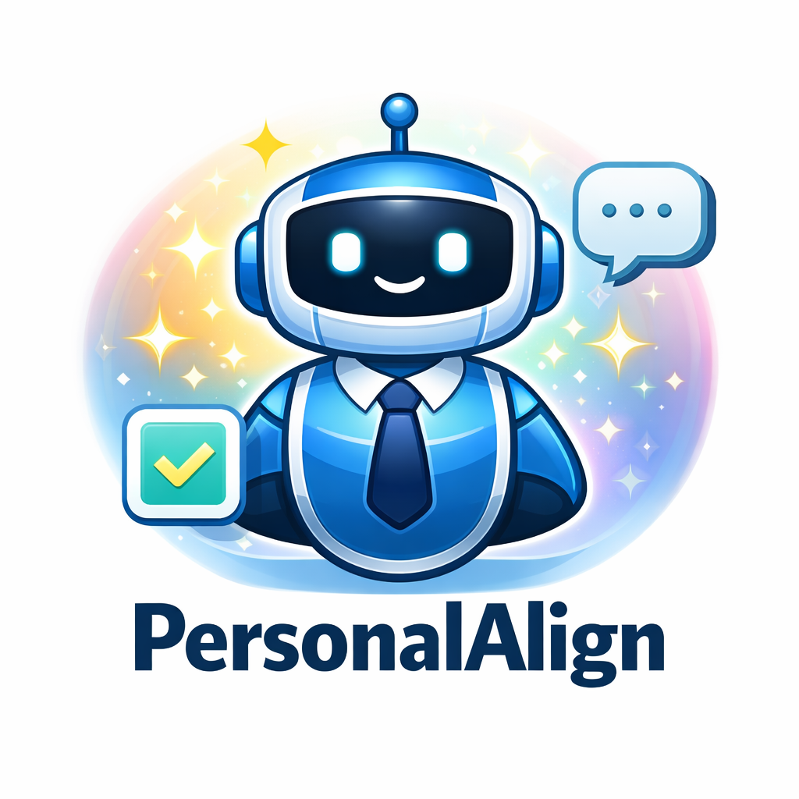
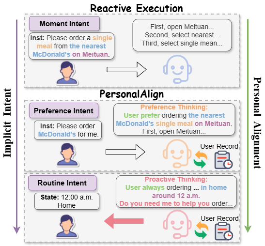

<div align="center">

<h2>
  
  <b><b>PersonalAlign: Hierarchical Implicit Intent Alignment for Personalized GUI Agent with Long-Term User-Centric Records</b></b>
</h2>

<div>
    <a href="https://weberLyu.github.io" target="_blank">Yibo Lyu</a>,
    <a href="https://scholar.google.com/citations?user=Mpg0w3cAAAAJ&hl=en&oi=ao" target="_blank">Gongwei Chen</a>,
    <a href="https://rshaojimmy.github.io/OrionLab/" target="_blank">Rui Shao*</a>,
    <a href="http://faculty.hitsz.edu.cn/guanweili" target="_blank">Weili Guan</a>,
    <a href="https://scholar.google.com/citations?hl=en&user=yywVMhUAAAAJ" target="_blank">Liqiang Nie*</a>
</div>

Harbin Institute of Technology, Shenzhen<br>
*Corresponding author


[](https://arxiv.org/abs/2601.09636)
[](https://jiutian-vl.github.io/PersonalAlign-page/)

</div>

<h4 align="center">
<strong>
Towards building more intelligent personalized agents for aligning with user's implicit intents.
<br>
<br>
<strong>
⭐ Give us a star if you like it! ⭐
<br>
✨If you find this work useful for your research, please kindly cite our paper.✨
</strong>
</h3>

## :books: Introduction
This is the official repository for **PersonalAlign: Hierarchical Implicit Intent Alignment for Personalized GUI Agent with Long-Term User-Centric Records**. In this work, we aim to build a more intelligent personalized GUI Agent capable of learning and matching implicit user intents from long-term interaction histories.

To this end, we constructed a new GUI benchmark, AndroidIntent. From 20k trajectories of different users over two months of mobile phone usage, we annotated 775 preference intents with 7,915 GUI actions and 215 routine intents for evaluation.


<div align="center">

</div>

## :package: Installation

```bash
# Create and activate conda environment
conda create -n personal python=3.10 -y
conda activate personal

git clone https://github.com/JiuTian-VL/PersonalAlign.git
cd PersonalAlign
pip install -r requirements.txt
```

## :robot: Evaluating your agent on AndroidIntent
First, please download the [Fingertip 20k](https://www.kaggle.com/datasets/qinglongyang/fingertip-20k) from Kaggle and extract it into the `./data` directory.

**Evaluate Agent Personalized Execution**
```Bash
sh scripts/execution/eval_qwen3vl.sh
```

**Evaluate Agent Proactive Suggestion**
```Bash
sh scripts/proactive/eval_proactive.sh
```

**Evaluate Agent Memory (HIM-Agent)**
```Bash
sh scripts/HIM_agent/eval_execution.sh
sh scripts/HIM_agent/eval_proactive.sh
```

**Evaluate TRACE (training-free long-horizon personalization)**

The cleaned implementation, complete result report, ablations, and
reproducibility commands are in
[trace_method/README.md](trace_method/README.md). The original HIM-Agent
implementation and evaluation scripts above are retained as the baseline.

Note: To prevent the agent from returning non-standard JSON that might interfere with API calls, we  inference-first and then evaluation. Specifically, results are saved and then calculated using `scripts/proactive/calculate.sh`


## :balloon: HIM-Agent
To support PersonalAlign, agent memory should generalize stable representations to exclude one-off moments while separating preferences and routines, and continuously evolve to stay aligned with user intents. We introduce HIM-Agent, a foundational and inspirational personal agent memory that enables GUI agents to rapidly leverage long-term records as context for personalization without interfering with original execution. We construct a streaming update memory and hierarchically organize memory prototypes into Preference Intent Memory and Routine Intent Memory through the execution-based and state-based filter to enable hierarchical intent alignment. 

## :memo: PersonalAlign.SKILL
We attempt to generalize our method into reusable skills, aiming to make it applicable beyond GUI scenarios to broader agent settings. We have implemented a preliminary skills-beta version, and the detailed design can be found in [README-skills](README-skills.md).

In migrating from the GUI setting to a more general agent scenario, we introduced several adaptations, while retaining the core components: daily-update, preference_memory, and routine_memory.


## :handshake: Acknowledgement
Many thanks to the contribution from [FingerTip](https://arxiv.org/abs/2507.21071). When training models or using the dataset for personal agent, please strictly respect and protect user privacy and data security. 

We sincerely apologize for the delay in open-sourcing. A server disk failure caused significant data loss, and we have tried our best to restore this repo. If PersonalAlign helps your research, please kindly consider giving us a Star🌟 to support us! 

If you find this work useful for your research, please also kindly cite our paper.
```
@article{lyu2026personalalign,
  title={PersonalAlign: Hierarchical Implicit Intent Alignment for Personalized GUI Agent with Long-Term User-Centric Records},
  author={Lyu, Yibo and Chen, Gongwei and Shao, Rui and Guan, Weili and Nie, Liqiang},
  journal={arXiv preprint arXiv:2601.09636},
  year={2026}
}
```
